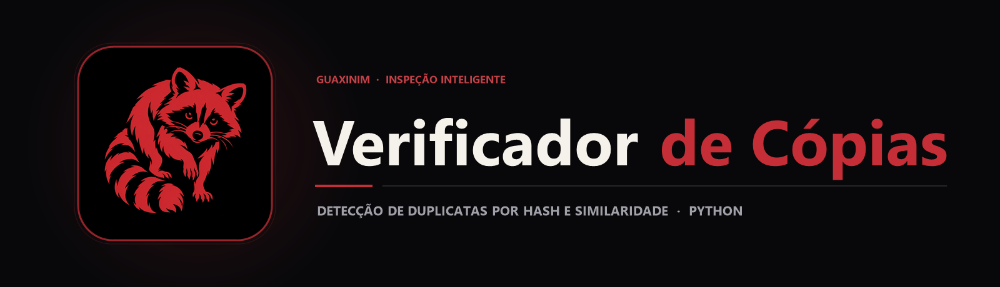

  

  Ferramenta desktop em Python que localiza e isola imagens duplicadas ou visualmente similares em diretórios locais usando Hash criptográfico e Perceptual Hashing.

  
  
  

## Sobre o projeto

Pastas de fotos e backups acumulam facilmente centenas de arquivos repetidos — seja por downloads duplicados, seja por imagens redimensionadas que possuem nomes diferentes. O **Verificador de Cópias** nasceu para automatizar essa faxina digital sem risco de apagar acidentalmente memórias importantes.

Construída em **Python** com interface gráfica **Tkinter**, a ferramenta varre o diretório escolhido, compara as imagens através de dois motores selecionáveis (cópia exata por Hash ou semelhança perceptual com tolerância ajustável) e move as duplicatas para uma subpasta organizada, registrando todo o processo em um log visual em tempo real.

  

## Principais recursos

| Recurso | Como funciona |
|---|---|
| Modo Hash Exato | Compara a assinatura binária dos arquivos para encontrar cópias 100% idênticas em altíssima velocidade. |
| Modo Similaridade Visual (ImageHash) | Gera uma impressão digital perceptual da imagem, detectando fotos iguais mesmo com resoluções ou compressões diferentes. |
| Controle de Tolerância | Barra deslizante na interface permite ajustar o quão parecidas duas imagens precisam ser para entrarem como duplicata. |
| Isolamento Seguro (Sem Exclusão Cega) | Em vez de deletar arquivos, move as cópias para uma pasta dedicada (padrão: duplicatas) e permite renomear originais (original_). |
| Log Passo a Passo | Painel de acompanhamento na própria janela mostrando cada arquivo analisado e movido. |

## Tecnologias

  
  
  
  

- **Python 3 (organizador.py)** como núcleo da aplicação;
- **Tkinter** para a interface gráfica desktop nativa;
- **Pillow (PIL Fork)** para abertura, decodificação e leitura de metadados das imagens;
- **ImageHash** para cálculo de hashes perceptuais e distância de Hamming;
- **os & shutil** para travessia segura de diretórios e movimentação de arquivos.

## Arquitetura

`mermaid
flowchart LR
    A[Pasta Selecionada pelo Usuário] --> B[Varredura de Imagens · Pillow]
    B --> C{Modo de Detecção}
    C -->|Hash Exato| D[Comparação Binária]
    C -->|Similaridade| E[ImageHash + Limiar de Tolerância]
    D --> F[Isolamento na Pasta de Duplicatas]
    E --> F
    F --> G[Relatório no Log da Interface]
`

## Estrutura do repositório

`	ext
Verificador-de-Copias/
├── assets/
│   ├── banner.png                  Banner principal Verificador de Cópias
│   └── project-animal.png          Símbolo do guaxinim
├── organizador.py                  Aplicação desktop completa (GUI + Motor de Hash)
└── README.md
`

## Executando o código

1. Clone o repositório e instale as dependências de imagem:
   `ash
   git clone https://github.com/arthurlynow098/Verificador-de-Copias.git
   cd Verificador-de-Copias
   pip install Pillow ImageHash
   `
2. Inicie a aplicação gráfica:
   `ash
   python organizador.py
   `
3. Selecione a pasta que deseja organizar, ajuste a tolerância (ou marque **Usar Hash**) e clique em **INICIAR PROCESSAMENTO**.

## Decisões técnicas

- **Mover em vez de excluir:** garante que o usuário possa revisar a pasta duplicatas antes de remover definitivamente qualquer arquivo do disco.
- **Combinação de Hash Exato e Perceptual:** oferece tanto velocidade máxima para backups idênticos quanto inteligência visual para fotos recompactadas pelo WhatsApp ou redes sociais.

---

Estudo · construção · evolução <a href="https://github.com/arthurlynow098">Perfil</a> · <a href="https://arthurentsev.vercel.app/">Portfólio</a> · <a href="https://www.linkedin.com/in/entsevarthur/">LinkedIn</a>

