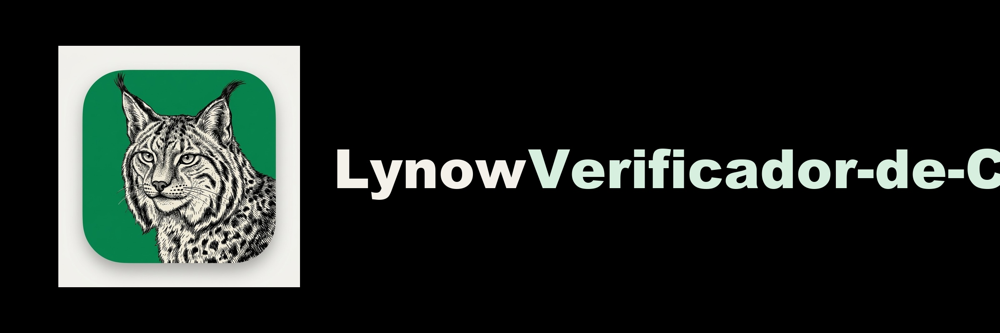
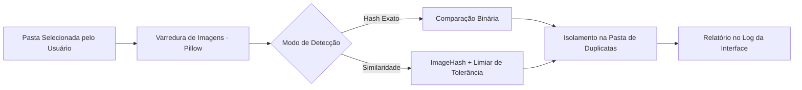

<p align="center"></p>

<p align="center">Ferramenta desktop para localizar imagens duplicadas ou semelhantes e separar as cópias em uma pasta.</p>


<p align="center"><a href="#visão-geral">Visão geral</a> &nbsp;·&nbsp; <a href="#recursos">Recursos</a> &nbsp;·&nbsp; <a href="#como-executar">Como executar</a></p>

<p align="center"></p>

<a id="explore-o-projeto"></a>

## Por onde começar


- **[Aplicação](organizador.py)** — Implementação da ferramenta desktop.
- **[Comparação](organizador.py)** — Consulte as rotinas de análise de imagens.
- **[Execução](README.md)** — Dependências e instruções de uso.


<a id="visão-geral"></a>

## Visão geral

Construída em **Python** com interface gráfica **Tkinter**, a ferramenta varre o diretório escolhido, compara as imagens através de dois motores selecionáveis (cópia exata por Hash ou semelhança perceptual com tolerância ajustável) e move as duplicatas para uma subpasta organizada, registrando todo o processo em um log visual em tempo real.

<p align="center">
  
</p>

<a id="recursos"></a>

## Recursos

**Modo Hash Exato**<br>
Compara a assinatura binária dos arquivos para encontrar cópias 100% idênticas em altíssima velocidade.

**Modo Similaridade Visual (ImageHash)**<br>
Gera uma impressão digital perceptual da imagem, detectando fotos iguais mesmo com resoluções ou compressões diferentes.

**Controle de Tolerância**<br>
Barra deslizante na interface permite ajustar o quão parecidas duas imagens precisam ser para entrarem como duplicata.

**Isolamento Seguro (Sem Exclusão Cega)**<br>
Em vez de deletar arquivos, move as cópias para uma pasta dedicada (padrão: duplicatas) e permite renomear originais (original_).

**Log Passo a Passo**<br>
Painel de acompanhamento na própria janela mostrando cada arquivo analisado e movido.

<a id="tecnologias"></a>

## Tecnologias

- **Python 3 (organizador.py)** como núcleo da aplicação;
- **Tkinter** para a interface gráfica desktop nativa;
- **Pillow (PIL Fork)** para abertura, decodificação e leitura de metadados das imagens;
- **ImageHash** para cálculo de hashes perceptuais e distância de Hamming;
- **os & shutil** para travessia segura de diretórios e movimentação de arquivos.

<details>
<summary>Arquitetura</summary>



</details>

<details>
<summary>Estrutura do repositório</summary>

```text
Verificador-de-Copias/
├── assets/
│   └── identity/banner.png               Banner do projeto
├── organizador.py                  Aplicação desktop completa (GUI + Motor de Hash)
└── README.md
```

</details>

<a id="como-executar"></a>

## Como executar

1. Clone o repositório e instale as dependências de imagem:
   ```bash
   git clone https://github.com/arthurlynow098/Verificador-de-Copias.git
   cd Verificador-de-Copias
   pip install Pillow ImageHash
   ```
2. Inicie a aplicação gráfica:
   ```bash
   python organizador.py
   ```
3. Selecione a pasta que deseja organizar, ajuste a tolerância (ou marque **Usar Hash**) e clique em **INICIAR PROCESSAMENTO**.

<a id="decisões-técnicas"></a>

## Decisões técnicas

- **Mover em vez de excluir:** garante que o usuário possa revisar a pasta duplicatas antes de remover definitivamente qualquer arquivo do disco.
- **Combinação de Hash Exato e Perceptual:** oferece tanto velocidade máxima para backups idênticos quanto inteligência visual para fotos recompactadas pelo WhatsApp ou redes sociais.

<p align="center"></p>

<p align="center">
  <a href="https://github.com/arthurlynow098">GitHub</a> &nbsp;·&nbsp;
  <a href="https://arthurentsev.vercel.app/">Portfólio</a> &nbsp;·&nbsp;
  <a href="https://www.linkedin.com/in/entsevarthur/">LinkedIn</a>
</p>
